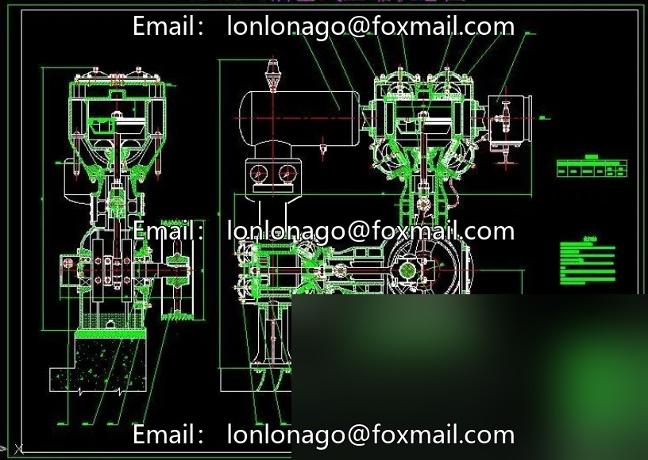
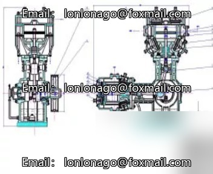
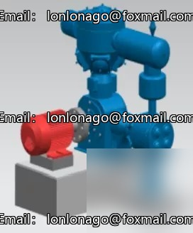

# L-type compressor CAD three-dimensional design diagram

## Body

L-shaped compressor CAD 3D design, L-shaped compressor design, L-shaped compressor figure, L-shaped compressor 3D figure, L-shaped compressor structural design.
L-shaped piston air compressor design, L-shaped compressor 2D figure design, L-shaped compressor 3D figure design, L-shaped compressor 2D figure design, L-shaped compressor 3D model design, L-shaped compressor 3D design.
This material contains 2 sets of CAD figures and 1 set of 3D figures, and can also be customized for design.
556

The content includes L-type compressor CAD three-dimensional design diagrams, L-type compressor two-dimensional design, and L-type compressor 3D model design.

<!-- AI_ENRICHED -->

## Images

## Payment

Here is a pay link on Stripe ( https://buy.stripe.com/3cs8yP7sY87d0vu9AB ). Please contact me lonlonago@foxmail.com after funding $89, and I will send you a complete data files , thank you!

